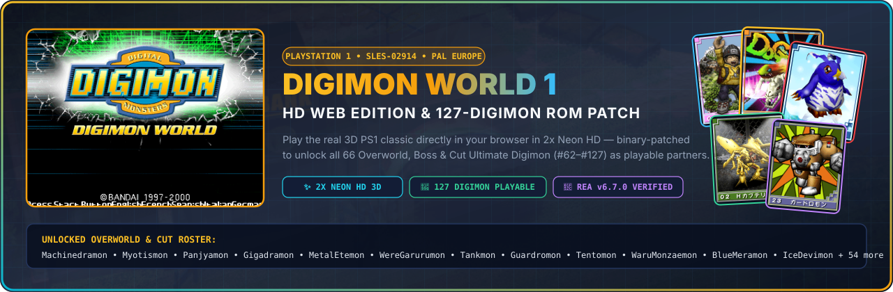
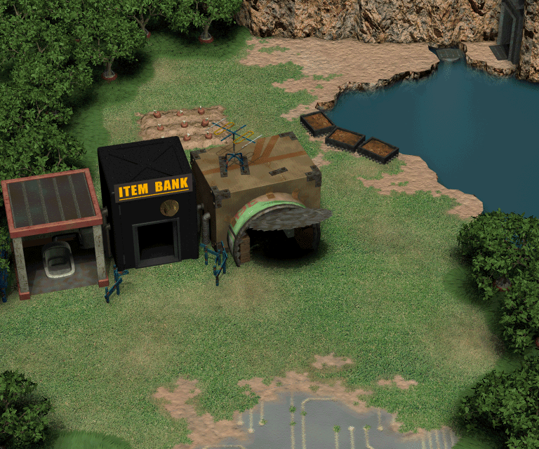
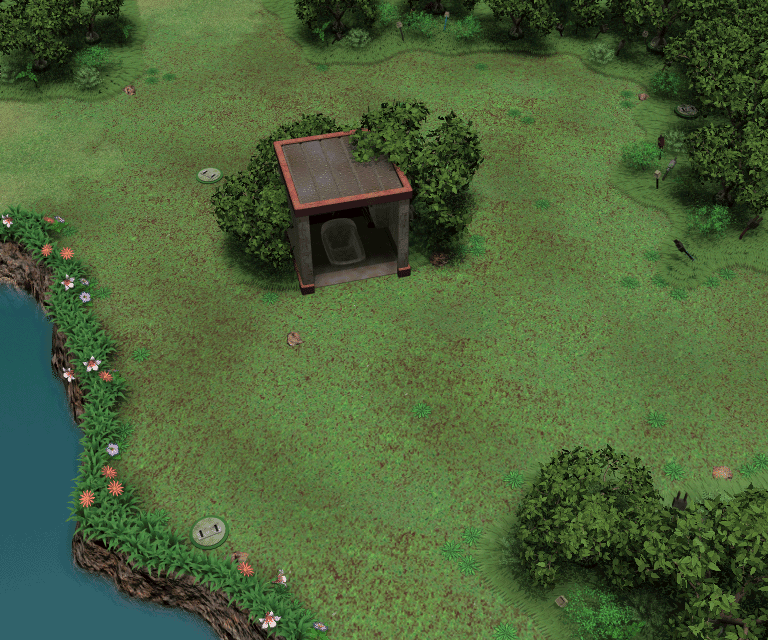
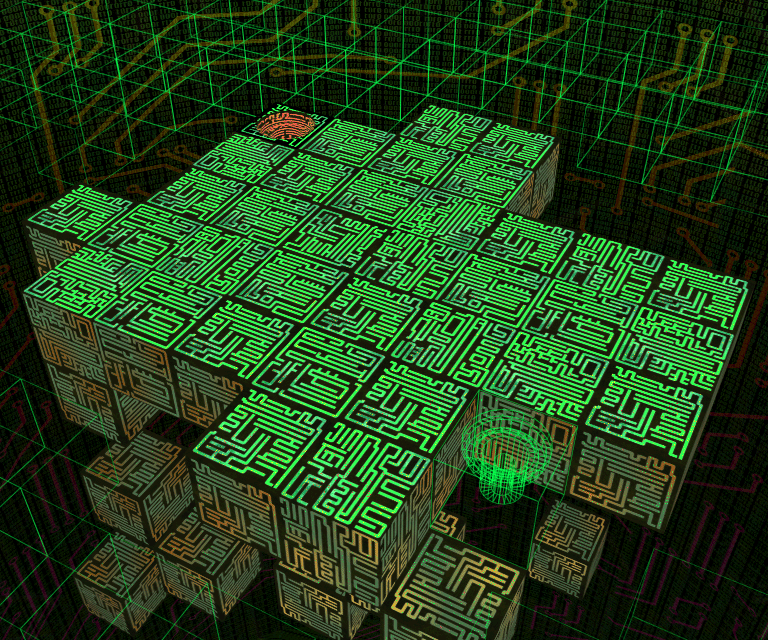
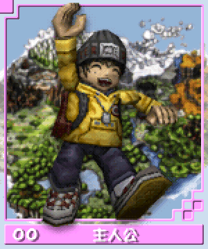
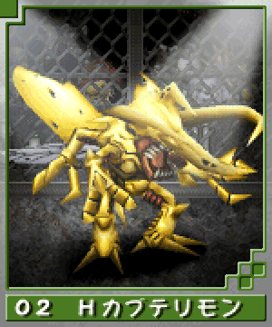
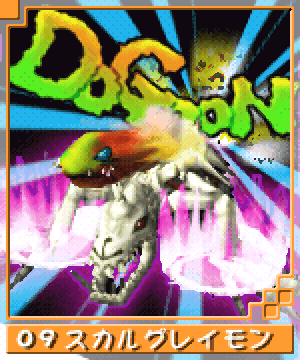
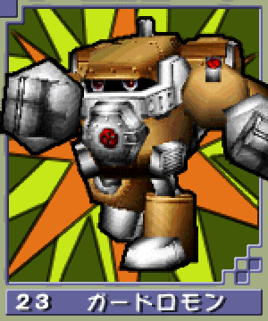
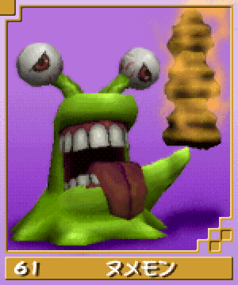

<div align="center">



<br />

# 🦖 Digimon World 1 — Web Edition (`SLES-02914`)
### **Play the Real PlayStation 1 Game Directly in Your Browser**

[](https://digimon-world-webui.vercel.app/)
[-f59e0b?style=for-the-badge&logo=playstation&logoColor=white)](https://digimon-world-webui.vercel.app/)
[](https://digimon-world-webui.vercel.app/)
[](LICENSE)

<p align="center">
  
</p>

**Play the authentic 3D PlayStation 1 game (`Digimon World (Europe)`) directly in your browser at 2x High-Definition resolution — binary-patched to unlock all 66 Overworld, Boss, and Cut Digimon (`#62`–`#127`) alongside the original 61 partners!**

[🚀 **Quick Start**](#-quick-start) • [🔓 **127-Digimon ROM Patch**](#-how-the-127-digimon-binary-rom-patch-works) • [🖼️ **Extracted HD Assets**](#️-decoded-3d-file-island-maps--hd-3d-cards) • [🧬 **PS1 Memory Map**](#-reverse-engineered-ps1-ram--executable-map-sles_02914) • [🎮 **Controls**](#-controls)

</div>

---

## ✨ Key Features

- 🎮 **Direct Instant-Boot 3D PS1 Gameplay**: Boots straight into the real PlayStation 1 game in your browser via WebAssembly (`PCSX-ReARMed` + WebGL2) with HTTP `206 Partial Content` CD-ROM streaming.
- 🔓 **Expanded 127-species ROM patch (`patch-ps1-rom.mjs`)**:
  - Expands the resident evolution, requirement, training, and stat-gain tables to 128 slots; redirects every verified reference in the main executable and training/evolution overlays; and generates a stage-correct evolution graph from the reverse-engineered species database.
  - Installs full-width IDs without the old destructive `0x3F` masks, generates valid partner move records, repairs missing V-Pet animation slots, and recalculates Mode 2 Form 1 CD-ROM EDC sector checksums. Vanilla executable/overlay hashes and structural assertions prevent patching an incompatible or already modified dump.
- ⚡ **Live Browser-to-PS1 RAM Injection Bar**:
  - Pick **any of the 127 Digimon** from the top bar dropdown and click **`✨ Instant Digivolve Partner`** — injects the target species ID directly into PS1 RAM (`0x8013BFE0` & `0x8013BFE2` inside the live WebAssembly `HEAPU8` memory), triggering the real in-game **3D Digivolution Cutscene** on the very next frame!
  - One-click **`⚡ Max 999 Stats & Moves`** writes `999` Offense/Defense/Speed/Brains, `9999` HP/MP, `0` Virus gauge, and all 128 technique bitflags directly to `0x8016C830..0x8016C85F`.
- ✨ **2x Neon HD Shader Pipeline**: Real-time switchable display presets (**2x Neon HD**, **Ultra Crisp**, **CRT Arcade**, and **Native PS1**) with bilinear texture smoothing and high-resolution PSX GPU scaling.

---

## 🆕 Latest Changes

- 🛠️ **Black-screen boot fix** — redistributable OpenBIOS with `pcsx_rearmed_bios = "auto"`, a 51 KB in-place runtime repair of the stale committed disc, seeded default controls, streamed filesystem patching, versioned service-worker cache and `window.DW1_BOOT_DIAGNOSTICS` stage/timeouts. Production headless verification reaches real 3D gameplay; see [validation](#validation-performed-for-this-fix).
- 🧬 **Safe expanded evolution storage** — the 10,384-byte resident block is decompressed at startup to `0x801C8CD0..0x801CB560`; the heap then begins at `0x801CB560`. This replaces the old experimental writes that overlapped live interrupt state at `0x8011B990` and `0x8011C000`.
- 🥚 **Data-driven Fresh and starter paths** — a 16-entry starter roster resides at `0x801CB550`, and Fresh evolution (including DemiMeramon) uses the expanded forward-path rows. The starter selector uses the opening script result's low four bits; live quiz coverage of every roster entry still needs emulator verification.
- 🏋️ **All table consumers redirected** — verified references in `SLES_029.14`, `EVL_REL.BIN`, `TRN_REL.BIN`, and `TRN2_REL.BIN` now use the expanded raise, requirement, stat-gain, and path tables. Reverse paths are derived from forward edges and validated against the engine's five-predecessor/six-target limits.
- 💾 **IndexedDB disc cache** — the ~240 MB disc is downloaded **once**, verified with SHA-256, and stored in the browser's IndexedDB. Return visits boot from local storage with no re-download; changed chunks are re-fetched automatically and stale chunks removed. Persistent storage is requested and quota/write failures fall back to normal streaming. Run `node add-manifest-hashes.mjs` after re-splitting the ROM to refresh hashes.
- ⚡ **True Instant-Play & Automatic Session Resume** — Clicking your browser bookmark instantly returns you directly into your active game session where you left off. The engine continuously saves live state snapshots and memory-card data quietly in the background (every 25s, on tab switch / window minimize, on pagehide, and at in-game save points) with zero lag or frame drops.
- 🛡️ **Safe Atomic Backups & Multi-Tab Protection** — Prevents save corruption by rejecting incomplete snapshots and retaining rolling versioned backups (last 15). Multi-tab coordination via BroadcastChannel prevents conflicting writes.
- ⚡ **Progressive Parallel Loading & PWA Service Worker** — Cached disc chunks are read concurrently via IndexedDB for near-instant return visits, while the Service Worker caches the EmulatorJS runtime, WebAssembly core, and UI assets for offline readiness.
- 💾 **Dual Save Export / Import** — Top-right controls allow exporting standard PS1 Memory Card (.srm) saves (for DuckStation/RetroArch) or instant live state snapshots (.state), restoring versioned backups, or starting a clean new game with automatic backup safeguards.
- 🐉 **Veemon stand-in** — species slot 114 is named Veemon and reuses Agumon's unmodified `AGUM` model/texture (there is no blue recolor). Veemon evolves from Koromon into Greymon, Angemon, Kabuterimon, or Garurumon. A separate DW3 model-import effort is not part of this patch.

**Next up:** gamepad polish, progressive first-playable loading.

---
## 🖼️ Decoded 3D File Island Maps & HD 3D Cards

All pre-rendered 3D File Island room backgrounds (`MAP/*.TFS`), 3D Bandai Digimon Cards (`CARD/*.TIM`), and UI textures were reverse-engineered and decoded directly from the CD-ROM sectors into `public/`:

### 🗺️ Pre-Rendered 3D File Island Backgrounds (`MAP/*.TFS`)
| **File City (`VILL01.TFS`)** | **Native Forest (`MAYO01.TFS`)** | **Freezeland (`FREEZ01.TFS`)** | **Mt. Infinity (`MUGEN01.TFS`)** |
| :---: | :---: | :---: | :---: |
|  |  |  |  |

### 🃏 2x EPX HD Bandai 3D Digimon Card Renders (`CARD/*.TIM`)
| **#03 Agumon** | **#05 Greymon** | **#12 MetalGreymon** | **#26 SkullGreymon** | **#54 Megadramon** | **#64 Machinedramon** |
| :---: | :---: | :---: | :---: | :---: | :---: |
|  |  |  |  |  |  |

---

## 🔓 How the 127-Digimon Binary ROM Patch Works

Running `node patch-ps1-rom.mjs` patches `rom/Digimon World (Europe).bin` in place. To preserve the clean dump, provide a separate output path:

```bash
node patch-ps1-rom.mjs --input /path/to/clean.bin --output /path/to/patched.bin
```

The patcher verifies the vanilla European `SLES_029.14` and `EVL_REL.BIN` SHA-1 hashes, builds and validates everything in memory, then writes the changed disc files and recalculates CD-ROM Mode 2 Form 1 EDC checksums.

| Area | Implementation |
| :--- | :--- |
| Expanded tables | 128 raise entries (28 bytes), 128 requirement entries (28 bytes), 128 stat-gain entries (14 bytes), 128 path rows (11 bytes), and a 16-byte starter roster are packed into a 10,384-byte resident block. |
| Startup decompression | Literal, fill, and back-reference streams occupy the old table storage. A leaf MIPS routine in two unreferenced EU library areas runs before `InitHeap3`, preserves its arguments, and decompresses the block before heap initialization. |
| Reference redirection | LUI/ADDIU and LUI/ORI references are redirected across all 17 executable/overlay text ranges. Expected reference counts and a zero-old-reference check reject incomplete or incompatible layouts. |
| Evolution logic | Forward paths enforce exact next-stage transitions. Reverse paths are derived automatically and capped at five entries. Fresh evolution uses the same expanded rows, so DemiMeramon has a defined path to Koromon. |
| Species and items | Database-derived IDs replace the old manual constants. Move/specialty/drop fields use verified 32-byte record offsets; Elec Ring targets Guardromon; vanilla item handlers and full-width target-ID loads are retained. |
| Models and animations | Slot 114 becomes Veemon with the `AGUM` fallback; Waregarurumon keeps `wEAG`. Empty animation slots are repaired using each runtime model's own `.MMD` file. |

`rom-expansion.mjs` contains the testable graph, compressor, MIPS builders, record patcher, and relocation logic. `npm test` executes the emitted routines in a MIPS test interpreter and does not require a ROM.

---

## 🦖 Species Coverage

Species IDs, levels, model codes, techniques, and item metadata come from `public/data/reverse-engineered-db.json`. The generated evolution graph checks that every non-NPC species is reachable through Fresh starts, starters, special/item evolution, or natural forward paths. Human NPC slots 116 and 118 are deliberately excluded from natural partner evolution.

---

## 🧬 Reverse-Engineered PS1 RAM & Executable Map (`SLES_029.14`)

Reverse-engineered using [`rea` (Reverse Engineering Assistant v6.7.0)](https://github.com/morluto/rea):

| PS1 Address / File Offset | Symbol / Structure | Description |
| :--- | :--- | :--- |
| `SLES_029.14 @ 0xA8B5C` | `g_DigimonSpeciesTable[128]` | `128 × 32-byte` records: radius/height/scale, type, level, three specialties, drop item/chance, and 16 technique bytes |
| `SLES_029.14 @ 0x9FCB8` | `g_TechniqueDataTable[121]` | `121 × 16-byte` battle technique records (power, MP cost, range, specialty, status, and accuracy data) |
| `SLES_029.14 @ 0xA0A58` | `g_ItemDataTable[128]` | `128 × 32-byte` item table (Price, Merit Value, Sort Category, Color Palette) |
| `SLES_029.14 @ 0xA10D8` | `g_EvolutionItemTargets[44]` | Maps item IDs 71–114 to their target Digivolution species IDs |
| `SLES_029.14 @ 0xA5114` | Vanilla `g_EvolutionStatGainTable[66]` | `66 × 14-byte` source entries; the patched runtime uses 128 entries at `0x801CA8D0` |
| `PS1 RAM @ 0x801C8CD0` | Expanded resident tables | Raise `0xE00`, requirements `0xE00`, stat gains `0x700`, paths `0x580`, then starters `0x10`; ends at `0x801CB560` |
| `PS1 RAM @ 0x8013BFE0` | `g_TargetEvolutionDigimonId` (`s16`) | Checked every frame at `0x800AA93C`. Setting to `1..127` + `[0x8013BFE2] = 1` triggers the 3D Evolution Cutscene |
| `PS1 RAM @ 0x8016C7F8` | `g_PartnerSpeciesId` (`u32`) | Active Partner Digimon Species ID (`1..127`) |
| `PS1 RAM @ 0x8016C830` | `g_PartnerStats` (`u16[4]`) | Partner Offense (`+0`), Defense (`+2`), Speed (`+4`), Brains (`+6`) (`max 999`) |
| `PS1 RAM @ 0x8016C840` | `g_PartnerHpMp` (`u16[4]`) | Max HP (`+0`), Max MP (`+2`), Current HP (`+4`), Current MP (`+6`) (`max 9999`) |
| `PS1 RAM @ 0x8016C850` | `g_LearnedTechniquesMask` (`u8[16]`) | 128-bit bitmask of all learned Digimon battle & finisher techniques |

---

## 🚀 Quick Start

### 1. Clone the Repository
```bash
git clone https://github.com/LIN4CRE/DigimonWorld1Web.git
cd DigimonWorld1Web
```

### 2. Place Your European PS1 ROM (`SLES-02914`) & Apply the 127-Digimon Patch
Place your `Digimon World (Europe).bin` inside `rom/Digimon World (Europe).bin` (or set `DIGIMON_ROM_ZIP` to your `.zip` archive), then run the binary patcher:
```bash
# Expands evolution data, redirects executable/overlay references, repairs MMD animations,
# and recalculates CD-ROM EDC checksums. The clean dump is verified before patching.
node patch-ps1-rom.mjs
```

### 3. Start the Server & Play Instantly
```bash
npm start
```
Open **[`http://localhost:3456`](http://localhost:3456)** in any modern browser!

Run the boot/configuration regression checks with:

```bash
npm test
```

### Why the old build showed a black screen

The committed disc chunks contained an older, boot-breaking patched `SLES_029.14`, and forcing `pcsx_rearmed_bios = "HLE"` hit a known Digimon World HLE failure (no first PlayStation frame). The current build fixes both at the emulator-loading level:

- pins EmulatorJS `4.2.3` and `pcsx_rearmed` instead of the moving `stable` CDN path;
- ships the MIT-licensed [PCSX-Redux OpenBIOS](public/bios/README.md) as `openbios.bin` and sets `pcsx_rearmed_bios = "auto"` — no proprietary Sony firmware is needed;
- applies a small, auditable [`disc-patch-v2.json`](public/rom/disc-patch-v2.json) to the decompressed disc in the EmulatorJS filesystem, upgrading the committed chunks to the repaired 127-species ROM expansion without replacing the 229 MB chunk files;
- primes the core options in `localStorage` before core load (EmulatorJS 4.2.3 otherwise applies `EJS_defaultOptions` too late);
- passes `EJS_biosUrl` as an **absolute URL string**, not a `File`. EmulatorJS 4.2.3's `downloadGameFile()` calls `.split('/')` on the BIOS value before it normalises a `File`, so the previous `File` value threw `TypeError: t.split is not a function`, rejected the boot promise right after the disc mounted, and left the page on a black screen;
- seeds control bindings as **numeric key codes**. EmulatorJS loads `controlSettings` from `localStorage` without running `setupKeys()`, so the earlier human-readable names (`"enter"`, `"up arrow"`) never equalled `event.keyCode`; the game ignored every key press and looped the intro forever. Existing stored names are migrated automatically on load;
- focuses the `#game` element when the game starts, so the first key press works without an extra click;
- serves `index.html`, the boot script, manifest, disc patch and OpenBIOS network-first from the service worker so a redeploy can never be pinned to a stale shell;
- exposes `window.DW1_BOOT_DIAGNOSTICS` with stage status for website load → manifest → chunks → BIOS → patch → CDN loader → core init → disc mount → `EJS_onGameStart` → first frame, plus stage timeouts and global error capture.

A hard refresh after deploying picks up the versioned boot script and the new service-worker cache. On a browser that already runs the previous service worker, one extra reload after the first visit may be needed for the new `dw1-v2.2.10` cache to take control. No BIOS upload is required. Audio and memory-card saves remain EmulatorJS defaults; headless verification cannot confirm audible sound, but nothing mutes or disables it.

### Why the controls did nothing

EmulatorJS 4.2.3 compares `controlSettings[player][button].value` directly with `event.keyCode`, a number. The boot script used to seed the pre-`setupKeys()` human names from EmulatorJS's own `defaultControllers` table (`"enter"`, `"up arrow"`, `"z"`). Because `controlSettings` is loaded from `localStorage` verbatim, `setupKeys()` never converted them, so every comparison failed and `simulateInput()` was never called. The emulator rendered the attract cutscene correctly, which made the build look healthy while all input was dropped.

Bindings are now stored as key codes (`13`, `38`, `90`, …) and any legacy names already in a visitor's storage are migrated on load. The `#game` element is also focused at game start so the first key press registers without a click, and controllers that were already connected before EmulatorJS initialised are assigned to player 1 automatically. Keyboard input is also rescued if focus drifts to the page background, and gamepads are polled repeatedly (and on the first user gesture) because Chrome only exposes Bluetooth controllers after a gesture.

### Validation performed for this fix

- `npm test`: **24/24 passing**, including new checks for OpenBIOS checksum, disc-patch structure, streamed FS repair, stage diagnostics, numeric control-settings seeding and legacy key-name migration, service-worker precache paths, static MIME types, Vercel cache headers, and the live deployment URL.
- Production-mode Chromium boot against the unmodified `emulator-boot.js` (`v2.2.10`): all stages reached `ok` — `bootScript`, `session`, `manifest`, `chunks`, `disc`, `coreSettings`, `emulatorConfig`, `bios`, `patchData`, `loader`, `ejsReady`, `discMount`, `discPatch`, `gameStart`, `controlsAudio`, `firstFrame`, and `serviceWorker`.
- `discPatch` applied **170 ranges / 8,770 bytes** in place with `FS.open('r+')`/`FS.read`/`FS.write`; the old whole-file `readFile`/`writeFile` path exhausted browser memory and was removed from the hot path.
- A headless run reached actual 3D *Digimon World* gameplay in File City after the Bandai/title/intro sequence, not merely `started=true` or a 1280×720 canvas. Memory-card `.srm` autosave hooks fired during the run.
- Service worker `dw1-v2.2.10` installed, activated and controlled a reload with **zero missing precache assets**; all local shell, OpenBIOS, licence, patch, manifest, webmanifest and icon URLs returned HTTP 200 with correct MIME types from the local preview server.
- `server.mjs` now serves `.md` as `text/markdown` and `.LICENSE` as `text/plain`; Vercel serves the boot script, service worker, OpenBIOS and patch with explicit no-cache/immutable headers.
- The committed 229 MB `part0.bin`…`part4.bin` and `manifest.json` are unchanged; the 51 KB repair patch is the only new disc asset. No proprietary Sony BIOS is present in the repository.

### Live deployment

- Primary Vercel production site: **<https://digimon-world-webui.vercel.app/>** — this is the deployment attached to the GitHub `main` branch. It serves `emulator-boot.js` `v2.2.10`, the `dw1-v2.2.10` service worker, `public/bios/openbios.bin`, `public/bios/OpenBIOS.LICENSE` and `public/rom/disc-patch-v2.json`.
- GitHub Pages mirror: **<https://lin4cre.github.io/DigimonWorld1Web/>** — the same build is published under `/public/`, with `v2.2.10` assets available from `/public/emulator-boot.js` and `/public/sw.js`.
- The older `digimon-world-1-web.vercel.app` hostname is a separate, stale Vercel project. It now returns a permanent redirect to the primary site and serves a self-destructing service worker that clears the old cache and unregisters itself, so old bookmarks recover automatically.
- PR [#4](https://github.com/LIN4CRE/DigimonWorld1Web/pull/4) was merged as `4739da4`; Vercel reported `Deployment has completed` and GitHub Pages reported `success`.

---

## 🎮 Controls

| PlayStation 1 Button | Default Keyboard Key | In-Game Action |
| :---: | :---: | :--- |
| **D-Pad** | `Arrow Keys` | Move Player / Navigate V-Pet Care Menus |
| **✕ (Cross)** | `X` | Confirm / Talk / Feed / Praise / Command Partner |
| **○ (Circle)** | `Z` | Cancel / Run |
| **△ (Triangle)** | `A` | Open Inventory / Partner Status Menu |
| **□ (Square)** | `S` | Check Map / Sub-Action |
| **Start** | `Enter` | Pause / Skip FMV Intro / Confirm Name |
| **Select** | `V` | Toggle UI Overlay |
| **L1 / R1 / L2 / R2** | `Q` / `E` / `Tab` / `R` | Shoulder buttons / camera and menu modifiers |

*(Full USB/Bluetooth Gamepad support is built in via the Web Gamepad API — press any button on your Xbox, DualSense, or DualShock controller to play!)*

---

## 📁 Repository Architecture

```text
DigimonWorld1Web/
├── public/
│   ├── index.html                  # Direct-boot 3D PS1 Web Edition + Live 127-Digimon RAM Unlocker Bar
│   ├── emulator.html               # Standalone/iframe full-screen emulator entry point
│   ├── emulator-boot.js            # Shared OpenBIOS boot, disc repair, diagnostics & save-control logic
│   ├── bios/                       # MIT-licensed PCSX-Redux OpenBIOS firmware + licence
│   ├── assets/                     # GitHub Hero Banner (SVG) & OpenGraph Social Card (PNG)
│   ├── cards/                      # 66 Decoded 2x EPX HD Bandai 3D Digimon Card Portraits (card_00..65.png)
│   ├── maps/                       # 9 Decoded Pre-Rendered 3D File Island .TFS Backgrounds (file_city.png, etc.)
│   ├── textures/                   # 14 Decoded 2x EPX HD PS1 .TIM UI & World Textures (TITLE256.png, etc.)
│   ├── rom/
│   │   ├── part0.bin … part4.bin  # Committed streamable disc chunks (unchanged by the boot fix)
│   │   ├── manifest.json          # Chunk sizes and SHA-256 integrity hashes
│   │   └── disc-patch-v2.json     # Small runtime repair from old patched disc to repaired ROM expansion
│   └── data/
│       └── reverse-engineered-db.json  # Complete extracted 127-Digimon, 121-Move, 128-Item & MIPS database
├── scripts/
│   └── generate-disc-patch.mjs    # Regenerates auditable disc-patch-v2.json from two raw disc images
├── server.mjs                      # Zero-dependency Node.js HTTP 206 Range-Streaming Server & MIPS Disassembler API
├── add-manifest-hashes.mjs         # Adds SHA-256 hashes + version to the ROM chunk manifest (IndexedDB cache)
├── split-rom-for-pages.mjs         # Splits the patched disc zip into <50 MB streamable chunks
├── patch-ps1-rom.mjs               # Clean-disc driver, EDC writer, and read-back verification
├── rom-expansion.mjs               # Evolution graph, compressor, MIPS builders, records, and relocation logic
├── test-support/mips-interpreter.mjs # Delay-slot-aware MIPS interpreter used by ROM-independent tests
├── extract-ps1-data.mjs            # ISO-9660 Sector Extractor & SLES_029.14 Struct Parser
├── extract-ps1-textures.mjs        # PS1 4/8/16-BPP .TIM Texture & 3D Card Decoder
├── extract-tfs-maps.mjs            # Pre-Rendered 3D File Island .TFS Map Background Decoder
├── upscale-hd.mjs                  # Pure-JS 2x EPX / Scale2x + Bilateral HD Texture Upscaler
├── generate-github-assets.mjs      # Pure-JS Generator for GitHub Banner, OpenGraph Card, Favicons & WebManifest
└── test/                           # Emulator boot checks plus ROM graph/compression/MIPS/record regression tests
```

---

## ⚖️ Legal & Disclaimer

This repository provides reverse-engineering research tools, binary patch scripts, and a browser interface. **No proprietary Sony PlayStation BIOS is distributed.** The browser emulator uses the MIT-licensed PCSX-Redux OpenBIOS image in [`public/bios/`](public/bios/README.md) with PCSX-ReARMed instead of Sony firmware or its incompatible HLE path. The committed chunk files and runtime patch contain *Digimon World* game data; that game is a registered trademark of **Bandai Namco Entertainment Inc.**
